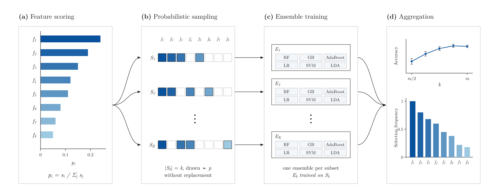

<p align="center">
  
  <br/>
  <sub><b>Figure 1.</b> Overview of PFSS. <b>(a)</b> Feature relevance scores <i>s<sub>i</sub></i> are normalised into selection probabilities <i>p<sub>i</sub></i>. <b>(b)</b> <i>K</i> subsets of <i>k</i> features are sampled without replacement according to <i>p</i>. <b>(c)</b> An ensemble of six classifiers is trained on each subset. <b>(d)</b> Accuracy is reported as a function of <i>k</i>, and how often each feature is selected measures its stability. Values are illustrative.</sub>
</p>

<h1 align="center">PFSS-Ensemble-Models</h1>

<p align="center">
  <b>Beyond Deterministic Selection: Probabilistic Feature Subset Selection for Medical Data</b>
  <br/>
  <sub>Soumen Sinha · Denis Krylov · Alexandru Grigore — Delft University of Technology</sub>
</p>

<p align="center">
  
  
  
  <a href="docs/report.pdf"></a>
  <a href="LICENSE"></a>
</p>

Most feature selection methods return one fixed subset of features. **PFSS** (Probabilistic Feature Subset Selection) instead turns feature-relevance scores into a probability distribution. It then samples many different subsets from that distribution and trains an ensemble of classifiers on them. Strong features show up often and weak ones occasionally, so the ensemble explores feature combinations while still favouring informative ones. How often each feature gets selected also measures how stable its importance is. We evaluate PFSS on four UCI medical datasets against two baselines: training on all features and uniform random sampling.

## Overview

- **Score.** Each feature is scored against the target with an information-theoretic or statistical metric: mutual information, Pearson correlation, Spearman rank correlation, an F-score, Shannon entropy or Random Forest importance.
- **Normalise.** The scores are normalised to sum to 1 and used as feature-selection probabilities.
- **Sample.** Subsets of *k* features are drawn without replacement using these probabilities, for every *k* from *m* (all features) down to *m*/2.
- **Train.** Each subset trains six classifiers: Random Forest, Gradient Boosting, AdaBoost, Logistic Regression, SVM and LDA. Accuracy is averaged over 10 sampled subsets per *k*.
- **Compare and explain.** Accuracy is also recorded with all features and with uniformly random subsets. Scoring methods are compared with each other and with random sampling using paired t-tests across subset sizes. Feature selection frequencies across the ensemble show which features are consistently important.

## Results

Best mean accuracy over 10 runs for each strategy, taking the best of the six classifiers. Figures are from Tables III–V of the [report](docs/report.pdf).

| Dataset | Features | All features | Random subsets | PFSS | Best PFSS configuration |
|---|:---:|:---:|:---:|:---:|---|
| Breast Cancer Wisconsin (Original) | 9 | 0.9561 | 0.9624 | 0.9649 | Random Forest · Linear Correlation · 8 features |
| Diabetic Retinopathy Debrecen | 19 | 0.7514 | 0.7497 | 0.7552 | Logistic Regression · Shannon Entropy · 16 features |
| Heart Failure Clinical Records | 12 | 0.8111 | 0.8111 | 0.8167 | Logistic Regression · Linear Correlation · 12 features |
| Statlog (Heart) | 13 | 0.8395 | 0.8395 | 0.8593 | AdaBoost · Information Gain · 11 features |

The gaps between strategies are small (at most 0.02, or one or two test samples), and they come from a single train/test split. PFSS also picks its best result from many more configurations than the baselines, so these figures do not show that PFSS is more accurate. Frequency analysis consistently ranks *ejection fraction* and *time* highest on Heart Failure, and *bare nuclei* and *normal nucleoli* highest on Breast Cancer.

## Quick start

```bash
git clone https://github.com/denskrlv/PFSS-Ensemble-Models.git
cd PFSS-Ensemble-Models
python -m venv .venv && source .venv/bin/activate
pip install -r requirements.txt
jupyter notebook notebooks/main.ipynb
```

The datasets are fetched from the [UCI Machine Learning Repository](https://archive.ics.uci.edu/) with [`ucimlrepo`](https://github.com/uci-ml-repo/ucimlrepo), so no manual download is needed.

### Use as a library

`src/utils.py` contains the reusable parts of the pipeline. Run this from the repository root:

```python
import pandas as pd
from sklearn.feature_selection import mutual_info_classif
from sklearn.model_selection import train_test_split

from src.utils import compute_feature_frequency, load_uci_dataset, train_ensemble_models

# Heart Failure Clinical Records (UCI #519)
_, df = load_uci_dataset(repo_id=519)
X, y = df.iloc[:, :-1], df.iloc[:, -1]
X_train, X_test, y_train, y_test = train_test_split(X, y, test_size=0.3, stratify=y, random_state=42)

# Score features and turn the scores into a sampling distribution
scores = mutual_info_classif(X_train, y_train)
probabilities = scores / scores.sum()

# Train 5 ensembles of 6 grid-searched classifiers, each on 6 sampled features
results = train_ensemble_models(X_train, X_test, y_train, y_test, probabilities,
                                n_ensembles=5, n_features_sample=6)

# How often was each feature selected?
frequency = compute_feature_frequency(results, X_train.shape[1])
print(pd.Series(frequency, index=X.columns).sort_values(ascending=False))
```

`train_ensemble_models` returns one record per ensemble and classifier, with the accuracy, the sampled feature indices and the best hyperparameters. If you call it with `probabilities=None`, it trains on all features instead.

## Details

<details>
<summary><b>Datasets</b></summary>

<br/>

| Dataset | UCI ID | Instances | Features | Name in the report |
|---|:---:|:---:|:---:|---|
| [Breast Cancer Wisconsin (Original)](https://archive.ics.uci.edu/dataset/15) | 15 | 699 | 9 | Breast Cancer / Breast Cancer Wisconsin |
| [Diabetic Retinopathy Debrecen](https://archive.ics.uci.edu/dataset/329) | 329 | 1151 | 19 | Diabetic Dataset |
| [Heart Failure Clinical Records](https://archive.ics.uci.edu/dataset/519) | 519 | 299 | 12 | Heart Failure |
| [Statlog (Heart)](https://archive.ics.uci.edu/dataset/145) | 145 | 270 | 13 | Liver Disorder |

Rows with missing values are dropped and targets are label-encoded. The report presents two runs, "Breast Cancer" and "Breast Cancer Wisconsin", but both use UCI #15. The Results table shows the first run.

`data/` also holds cached copies of the breast cancer data and the [HCV dataset](https://archive.ics.uci.edu/dataset/571), which is used in `src/hep_c.ipynb`.

</details>

<details>
<summary><b>Feature scoring methods</b></summary>

<br/>

| Method | Implementation |
|---|---|
| Mutual Information | `sklearn.feature_selection.mutual_info_classif` |
| Linear Correlation | Pearson *r* between each feature and the target |
| Spearman Rank Correlation | `scipy.stats.spearmanr` |
| Information Gain | ANOVA F-statistic, `sklearn.feature_selection.f_classif` |
| Shannon Entropy | `scipy.stats.entropy` of each feature's values |
| Interaction Scores | Random Forest feature importances averaged over trees (`src/` notebooks) |

Features with a score of zero are never sampled. If fewer than *k* features have a nonzero score, the subset size is reduced to match.

</details>

<details>
<summary><b>Classifiers and hyperparameters</b></summary>

<br/>

The main experiments use scikit-learn defaults (`random_state=42`). `train_ensemble_models` in `src/utils.py` tunes each classifier with `GridSearchCV` (5-fold by default) over the following grid:

| Classifier | Grid |
|---|---|
| Random Forest | `n_estimators` ∈ {50, 100}, `max_depth` ∈ {10, 20, None} |
| Gradient Boosting | `n_estimators` ∈ {50, 100}, `learning_rate` ∈ {0.01, 0.1, 1.0} |
| AdaBoost | `n_estimators` ∈ {50, 100}, `learning_rate` ∈ {0.5, 1.0, 2.0} |
| Logistic Regression | `C` ∈ {0.1, 1.0, 10.0}, `penalty` = l2 |
| SVM (RBF) | `C` ∈ {1, 10, 100}, `gamma` ∈ {scale, auto} |
| LDA | `solver` ∈ {lsqr, eigen}, `shrinkage` ∈ {None, auto} |

</details>

<details>
<summary><b>Reproducing the experiments</b></summary>

<br/>

[`notebooks/main.ipynb`](notebooks/main.ipynb) contains the full study, with one experiment cell per dataset. Each cell writes two files next to the notebook:

- `final_results_<dataset>.csv` — accuracy of every run, for every method, classifier and subset size *k*
- `summary_results_<dataset>.csv` — mean and standard deviation of accuracy over the 10 runs

The cells at the end of the notebook read the summary files. They run paired t-tests between methods (`scipy.stats.ttest_rel`), pick the best configuration per classifier, and plot accuracy against the number of features.

</details>

<details>
<summary><b>Repository layout</b></summary>

<br/>

```
PFSS-Ensemble-Models/
├── notebooks/
│   └── main.ipynb                # Full study: experiments, t-tests, plots
├── src/
│   ├── utils.py                  # Data loading, probabilistic sampling, ensemble training
│   ├── breast_cancer.ipynb       # Per-dataset walkthroughs built on utils.py
│   ├── heart_failure.ipynb
│   ├── hep_c.ipynb
│   └── refactored_example.ipynb  # Discretising continuous features into bins
├── data/                         # Cached UCI datasets
├── docs/
│   └── report.pdf                # Project report
├── images/                       # README banner and its generator (make_thumbnail.py)
├── requirements.txt
└── LICENSE
```

</details>

## Citation

```bibtex
@misc{ska2025pfss,
  author       = {Soumen Sinha and Denis Krylov and Alexandru Grigore},
  title        = {Beyond Deterministic Selection: A Probabilistic Approach for Feature Subset Selection in Medical Data},
  year         = {2025},
  institution  = {Delft University of Technology},
  howpublished = {\url{https://github.com/denskrlv/PFSS-Ensemble-Models}}
}
```

## License

Released under the [MIT License](LICENSE).
